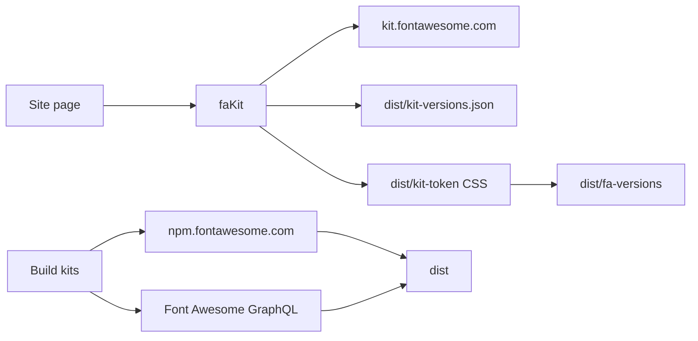

# Overview

[Docs index](README.md)

Font Awesome kits normally load from `https://kit.fontawesome.com/{token}.js`. This repo keeps a local copy of the same kit and loads it when that CDN font does not come up.

Two programs do that work:

- [`src/faKit.client.ts`](../src/faKit.client.ts) runs in the browser. It injects the CDN kit script, looks up the kit's major version, and adds a local stylesheet if `document.fonts.load` rejects.
- [`src/buildKits.ts`](../src/buildKits.ts) runs in Node. It lists kits on the Font Awesome account, installs each `@awesome.me/kit-{token}` package, and writes the fallback CSS and webfonts into `dist/`.

[`src/GQLClient.client.ts`](../src/GQLClient.client.ts) is the API client the build uses to list kits. It can also list family styles and run GraphQL introspection. See [Font Awesome API](font-awesome-api.md).

## What a site needs

The fallback matches the CDN kit only when that kit has been built into this repo.

- The kit token must appear in [`dist/kit-versions.json`](../dist/kit-versions.json). The loader uses that file to choose the font family name (`Font Awesome 6 Pro`, `Font Awesome 7 Pro`, and so on). If the token is missing, the loader does not add a stylesheet.
- The kit stylesheet must exist at `dist/kit-{token}/`. The build writes each `all*` and `fontawesome*` CSS file from the kit package there.
- Those stylesheets point at shared webfonts under `dist/fa-versions/{version}/`.

Details for page authors are in [Using the loader](using-the-loader.md). How those files are produced is in [Building kits](building-kits.md) and [Output layout](output-layout.md).

## Account and registry

The build talks to two Font Awesome credentials:

| Variable | Used for |
| --- | --- |
| `FA_API_TOKEN` | Exchanged for a short-lived bearer token at `https://api.fontawesome.com/token`, then sent to the GraphQL API |
| `FA_PKG_TOKEN` | Sent to npm as `FONTAWESOME_PACKAGE_TOKEN` so `@awesome.me` packages can be installed from `https://npm.fontawesome.com/` |

[`.npmrc`](../.npmrc) points `@awesome.me` and `@fortawesome` at that registry and reads `FONTAWESOME_PACKAGE_TOKEN` from the environment. Do not commit either token. `.env` is gitignored.

Each kit that should be installable needs the package feature turned on in the Font Awesome kit settings. Kits without a package fail `npm install` and are recorded in `dist/kit-results.json` under `not_installed`.

## Next

- [Using the loader](using-the-loader.md)
- [Building kits](building-kits.md)
- [GitHub Action](github-action.md)
